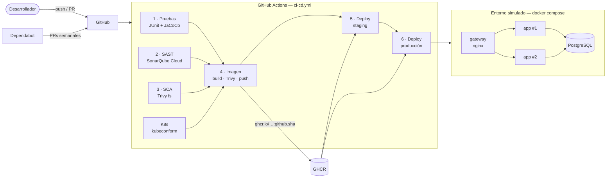
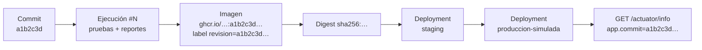

# Order Manager API — Pipeline CI/CD

[](../../actions/workflows/ci-cd.yml)

Microservicio REST de gestión de pedidos para un e-commerce (Spring Boot 3.5 · Java 17), con su ciclo de vida
automatizado de punta a punta en **GitHub Actions**: pruebas, análisis de seguridad, contenerización,
despliegue automático en un entorno cloud simulado y orquestación con Docker Compose.

> **Asignatura:** DOY0101 Ingeniería DevOps — Evaluación Parcial N°2
> **Integrantes:** _Nombre Apellido_ · _Nombre Apellido_

---

## Índice

1. [Arquitectura](#1-arquitectura)
2. [Contenerización — IE1](#2-contenerización--ie1)
3. [Pipeline CI/CD](#3-pipeline-cicd)
4. [Pruebas automatizadas y política de calidad — IE2](#4-pruebas-automatizadas-y-política-de-calidad--ie2)
5. [Seguridad y escalabilidad en el pipeline — IE3](#5-seguridad-y-escalabilidad-en-el-pipeline--ie3)
6. [Despliegue automático y trazabilidad — IE4](#6-despliegue-automático-y-trazabilidad--ie4)
7. [Orquestación de contenedores — IE5](#7-orquestación-de-contenedores--ie5)
8. [Instrucciones de ejecución](#8-instrucciones-de-ejecución)
9. [Configuración del repositorio](#9-configuración-del-repositorio)
10. [API](#10-api)
11. [Declaración de uso de IA](#11-declaración-de-uso-de-ia)
12. [Conclusiones y reflexiones individuales](#12-conclusiones-y-reflexiones-individuales)

---

## 1. Arquitectura



| Componente | Tecnología | Archivo |
|---|---|---|
| Microservicio | Spring Boot 3.5.16, Java 17, JPA | `src/` |
| Imagen | Docker multi-stage, `eclipse-temurin:17-jre-alpine` | [`Dockerfile`](Dockerfile) |
| Pipeline | GitHub Actions | [`.github/workflows/ci-cd.yml`](.github/workflows/ci-cd.yml) |
| Dependencias | Dependabot | [`.github/dependabot.yml`](.github/dependabot.yml) |
| SAST | SonarQube Cloud (scanner Maven) | [`pom.xml`](pom.xml) (`sonar.*`) + parámetros en `ci-cd.yml` |
| SCA / imagen | Trivy | [`.trivyignore.yaml`](.trivyignore.yaml) |
| Orquestación | Docker Compose + nginx | [`docker-compose.yml`](docker-compose.yml), [`nginx/nginx.conf`](nginx/nginx.conf) |
| Orquestación (clúster) | Kubernetes + Kustomize | [`k8s/`](k8s/) |
| Despliegue por etapas | Workflow reutilizable | [`.github/workflows/deploy.yml`](.github/workflows/deploy.yml) |
| Perfil contenedor | Spring profile `docker` | [`application-docker.properties`](src/main/resources/application-docker.properties) |

---

## 2. Contenerización — IE1

El [`Dockerfile`](Dockerfile) usa **tres etapas**:

| Etapa | Imagen base | Propósito |
|---|---|---|
| `build` | `maven:3.9-eclipse-temurin-17` | Descarga dependencias (capa cacheada) y empaqueta el JAR |
| `extract` | `eclipse-temurin:17-jre-alpine` | Separa el fat-jar en capas de Spring Boot (`layertools`) |
| `runtime` | `eclipse-temurin:17-jre-alpine` | Solo JRE + aplicación (~245 MB vs. ~600 MB con JDK completo) |

Decisiones de optimización y seguridad:

- **Caché de capas:** `pom.xml` se copia antes que `src/`, así un cambio de código no vuelve a descargar dependencias.
  Las capas de Spring Boot se copian de menos a más cambiante (`dependencies` → `application`), por lo que una
  nueva versión solo modifica la última capa (~50 KB) al hacer push/pull.
- **Usuario no-root:** `USER appuser` (UID 10001) sin shell de login.
- **Parches del SO:** `apk upgrade` en la etapa final elimina CVEs ya corregidos de la imagen base.
- **JVM consciente del contenedor:** `-XX:MaxRAMPercentage=75` adapta el heap al límite de memoria asignado;
  `-XX:+ExitOnOutOfMemoryError` permite que el orquestador reinicie un contenedor degradado.
- **`HEALTHCHECK`** sobre `/actuator/health/liveness`.
- **Labels OCI** (`title`, `version`, `revision`, `created`) en el `Dockerfile`; en el pipeline `docker/metadata-action`
  agrega además `source` y `url`, enlazando la imagen con el repositorio y el commit.
- [`.dockerignore`](.dockerignore) limita el contexto de build a `pom.xml` y `src/`.

---

## 3. Pipeline CI/CD

Archivo: [`.github/workflows/ci-cd.yml`](.github/workflows/ci-cd.yml)

| # | Job | Se ejecuta en | Qué hace | Bloquea si… |
|---|---|---|---|---|
| 1 | **Pruebas** | push, PR | `mvn verify`: 55 pruebas JUnit 5 (unitarias + integración) + reporte JaCoCo + `jacoco:check` | falla una prueba o cobertura < 80% |
| 2 | **SAST** | push, PR | Análisis SonarQube Cloud con `sonar.qualitygate.wait=true` | no se cumple el Quality Gate, o falta `SONAR_TOKEN` en `main` |
| | **Dependabot · Revisión de dependencias** | PR | `dependency-review-action` compara las dependencias del PR contra la GitHub Advisory Database (la misma fuente de Dependabot) | el PR introduce una dependencia con vulnerabilidad HIGH/CRITICAL |
| 3 | **SCA** | push, PR | Trivy `fs`: CVEs en dependencias Maven, secretos expuestos y malas prácticas en el Dockerfile | hallazgos HIGH/CRITICAL |
| | **Kubernetes** | push, PR | `kubectl kustomize k8s` + `kubeconform -strict` valida los manifiestos contra el esquema de Kubernetes 1.30 | manifiesto inválido |
| 4 | **Imagen** | push, PR | Build multi-stage → escaneo Trivy de la imagen → push a GHCR (solo `main`) | imagen con CVEs HIGH/CRITICAL |
| 5 | **Deploy staging** | push a `main` | `docker compose up` de la imagen recién publicada (1 réplica), verificación de trazabilidad, pruebas de humo | algún servicio no queda *healthy* o falla una prueba de humo |
| 6 | **Deploy producción** | tras staging exitoso | Misma imagen (mismo SHA) con 2 réplicas en el entorno `produccion-simulada`; admite **aprobación manual** | igual que staging |
| | **Alerta** | push a `main` | Si falla un control de seguridad, crea o comenta un issue `security-gate` | — |

Los jobs 1, 2, 3 y la validación de Kubernetes corren **en paralelo**; el build solo comienza si todos pasan
(*quality gate*), y el despliegue solo si la imagen pasó su propio escaneo. Producción solo recibe la imagen que ya
superó staging. Ambos despliegues usan el mismo workflow reutilizable
([`deploy.yml`](.github/workflows/deploy.yml)), por lo que el procedimiento es idéntico en cada etapa.

---

## 4. Pruebas automatizadas y política de calidad — IE2

**Suite (55 pruebas, JUnit 5 + Mockito + MockMvc + H2):**

| Clase | Tipo | Casos críticos cubiertos |
|---|---|---|
| `OrderTest` (6) · `OrderItemTest` (5) | Unitarias de dominio | Validaciones de invariantes, cálculo de subtotales y totales, valores por defecto al persistir, igualdad de entidades |
| `OrderServiceTest` (22) | Unitarias | Creación con/sin ítems, **máquina de estados completa** (PENDING → CONFIRMED → SHIPPED → DELIVERED, cancelaciones), **todas** las transiciones inválidas, pedido inexistente, verificación de que no se persiste ante error |
| `OrderControllerTest` (18) | Integración web | Todos los endpoints; códigos 200/201/204/400/404/409/500; validación de entrada, JSON mal formado, estado desconocido, errores internos sin filtrar detalles |
| `OrderApiIntegrationTest` (4) | Integración completa | Contexto Spring + JPA + H2: ciclo de vida del pedido de punta a punta, reglas de negocio persistidas, filtros, eliminación y *health probes* de Actuator |

**Política de calidad aplicada automáticamente:**

| Regla | Dónde se aplica | Efecto |
|---|---|---|
| 0 pruebas fallidas | Job 1 (`mvn verify`) | Bloquea build y deploy |
| Cobertura de líneas ≥ 80% (actual: 94.6%) | `jacoco:check` en `pom.xml` (`jacoco.minimum.line.coverage`) | Bloquea build y deploy |
| Quality Gate de SonarQube (bugs, vulnerabilidades, code smells, cobertura en código nuevo) | Job 2 | Bloquea build y deploy |
| Pruebas de humo post-despliegue | Job 5 ([`scripts/smoke-test.sh`](scripts/smoke-test.sh)) | Marca el despliegue como fallido |

Cada ejecución publica un resumen (total, fallidas, cobertura) en el *Step Summary* y sube los reportes
Surefire y JaCoCo como artefacto (`test-reports-<sha>`, 30 días).

---

## 5. Seguridad y escalabilidad en el pipeline — IE3

### 5.1 Controles de seguridad

| Control | Herramienta | Alcance |
|---|---|---|
| Escaneo de dependencias | **Dependabot** (alertas + PRs semanales para Maven, Dockerfile, Compose y Actions) + job **Revisión de dependencias** en cada PR | Mantiene versiones parchadas; un PR que introduce una dependencia vulnerable queda bloqueado |
| Análisis estático (SAST) | **SonarQube Cloud** | Vulnerabilidades, *security hotspots*, bugs y code smells en el código Java |
| SCA + secretos + IaC | **Trivy fs** | CVEs en el árbol de dependencias, credenciales filtradas, reglas de buenas prácticas del Dockerfile |
| Escaneo de imagen | **Trivy image** | CVEs del SO base y de los JARs dentro de la imagen final |
| Supply chain del pipeline | Acciones fijadas por **SHA de commit** + Dependabot para actualizarlas | Evita que un tag modificado inyecte código en el pipeline |
| Mínimo privilegio | `permissions: contents: read` global; cada job amplía solo lo necesario | Limita el alcance del `GITHUB_TOKEN` |
| Secretos | `SONAR_TOKEN` en GitHub Secrets; contraseña de BD **efímera** generada y enmascarada por despliegue | Ningún secreto en el repositorio (`.env` en `.gitignore`) |

### 5.2 Alertas y bloqueos

1. **Bloqueo:** cada control termina con `exit-code: 1` / Quality Gate; un fallo detiene los jobs dependientes,
   por lo que **ninguna imagen vulnerable llega a GHCR ni se despliega**.
2. **Alerta en GitHub Security:** los hallazgos de Trivy se publican en formato SARIF en *Security → Code scanning*.
3. **Alerta por issue:** el job `security-alert` abre (o comenta) un issue con la etiqueta `security-gate`, el commit
   y el enlace a la ejecución. GitHub notifica por correo a quienes observan el repositorio.
4. **Comentario en el PR:** si la revisión de dependencias falla, el job comenta en el PR qué paquete y qué CVE lo bloquearon.
5. **SAST obligatorio:** en `main` el job SAST falla si `SONAR_TOKEN` no está configurado, por lo que el análisis de código no puede omitirse en silencio.
6. **Protección de rama** (ver [§9](#9-configuración-del-repositorio)): impide hacer *merge* de un PR si algún check falla.

### 5.3 Gestión de vulnerabilidades (evidencia)

El primer escaneo de la versión original (Spring Boot 3.3.4) detectó **43 vulnerabilidades HIGH/CRITICAL**
(entre ellas RCE en Tomcat, CVE-2025-24813). Se corrigieron así:

| Acción | Resultado |
|---|---|
| Spring Boot 3.3.4 → 3.5.16 | 43 → 11 |
| Overrides de versión en `pom.xml`: `jackson-bom` 2.21.7, `tomcat` 10.1.60, `postgresql` 42.7.12; `apk upgrade` en la imagen | 11 → 2 |
| Excepción documentada en [`.trivyignore.yaml`](.trivyignore.yaml) | 2 → 0 |

Las 2 excepciones (CVE-2026-47884, CVE-2026-47890 en `spring-webmvc`) **no son explotables** en este servicio:
requieren `XsltView` o Server-Sent Events con vistas, y la API solo serializa JSON. Su corrección existe únicamente en
Spring Framework 7 (Spring Boot 4). Cada excepción tiene justificación y **fecha de expiración (2027-01-31)**: al
vencer, Trivy vuelve a bloquear el pipeline y obliga a re-evaluar.

### 5.4 Parámetros de escalabilidad y desempeño

| Parámetro | Valor | Dónde |
|---|---|---|
| Réplicas del microservicio | `APP_REPLICAS=2` (configurable) | `docker-compose.yml` |
| Balanceo de carga | nginx `least_conn` sobre todas las réplicas, con failover (`max_fails`, `proxy_next_upstream`) | `nginx/nginx.conf` |
| Límite CPU / memoria app | 1 CPU / 768 MB (reserva 0.25 / 384 MB) | `docker-compose.yml` |
| Límite CPU / memoria BD | 1 CPU / 512 MB | `docker-compose.yml` |
| Heap JVM | 75% del límite del contenedor | `Dockerfile` / Compose |
| Pool de conexiones | Hikari `DB_POOL_SIZE=10` por réplica | `application-docker.properties` |
| Rate limiting | 50 req/s por IP (ráfaga 100) | `nginx/nginx.conf` |
| Apagado ordenado | `server.shutdown=graceful` + `stop_grace_period: 30s` | Compose / perfil docker |
| Caché del pipeline | Maven (`setup-java`) y capas Docker (`type=gha`) | `ci-cd.yml` |
| Concurrencia | Cancela ejecuciones obsoletas de un mismo PR | `ci-cd.yml` |

---

## 6. Despliegue automático y trazabilidad — IE4

### 6.1 Entorno cloud simulado y promoción entre etapas

Hay dos entornos de GitHub, recorridos en orden por la **misma imagen inmutable** (`:<github.sha>`):

| Etapa | Entorno GitHub | Réplicas | Puerta de entrada |
|---|---|---|---|
| Desarrollo | rama / PR | — | pruebas, SAST, SCA, validación K8s, escaneo de imagen |
| Staging | `staging` | 1 | pipeline verde en `main` |
| Producción | `produccion-simulada` | 2 | staging exitoso (+ aprobación manual opcional, ver §9) |

En cada etapa el runner de GitHub actúa como servidor: descarga desde GHCR **exactamente la imagen etiquetada con el
SHA del commit**, levanta el stack con `docker compose up --wait` (espera a que todos los healthchecks estén
*healthy*), ejecuta pruebas de humo contra el gateway y finalmente libera el entorno. Cada despliegue queda registrado
como *deployment* en su entorno de GitHub, visible en la página principal del repositorio (*Deployments*).

### 6.2 Cadena de trazabilidad



| Desde → Hasta | Mecanismo |
|---|---|
| Commit → ejecución | Cada ejecución de Actions está ligada al SHA; el *Step Summary* enlaza commit, autor y rama |
| Ejecución → evidencias de calidad | Artefacto `test-reports-<sha>`, análisis en SonarQube asociado al commit, SARIF en Security |
| Commit → imagen | Tag `:<github.sha>` (y `:sha-<corto>`) + label OCI `org.opencontainers.image.revision` |
| Imagen → despliegue | Staging y producción usan `APP_IMAGE=…:<github.sha>` y **verifican** que la label `revision` de cada contenedor coincida con el commit; si no, falla |
| Staging → producción | `deploy-production` depende de `deploy-staging` en la misma ejecución: no se puede promover una imagen que no pasó staging |
| Despliegue → aplicación en ejecución | `GET /actuator/info` devuelve `app.version` y `app.commit` |

Cada despliegue genera un **resumen** en la pestaña *Summary* de la ejecución con: commit, autor, rama, número de
ejecución, imagen, digest, versión, resultado de pruebas y cobertura, réplicas activas, estado de los servicios,
consumo de CPU/memoria frente a los límites y el resultado de las pruebas de humo.

---

## 7. Orquestación de contenedores — IE5

Se entregan dos estrategias complementarias: **Docker Compose** (la que ejecuta el pipeline en el entorno simulado) y
**Kubernetes** (manifiestos para un clúster real, validados en cada ejecución del pipeline).

### 7.1 Docker Compose

Tres servicios y dos redes aisladas.

| Servicio | Imagen | Réplicas | Healthcheck | Red |
|---|---|---|---|---|
| `gateway` | `nginxinc/nginx-unprivileged:1.30-alpine` | 1 | `/nginx-health` | frontend + backend |
| `app` | `ghcr.io/<owner>/order-manager:<sha>` | 2 (escalable) | `/actuator/health/readiness` (incluye BD) | backend |
| `db` | `postgres:17-alpine` | 1 + volumen `pgdata` | `pg_isready` | backend |

Mecanismos de estabilidad:

- **Arranque ordenado:** `depends_on: condition: service_healthy`: la app espera a que PostgreSQL acepte conexiones,
  y el gateway a que la app esté lista. Con `restart: true`, si la BD se reinicia, la app también lo hace.
- **Autorecuperación:** `restart: unless-stopped` + healthchecks; `ExitOnOutOfMemoryError` fuerza el reinicio de una
  réplica degradada, mientras nginx (`max_fails` / `proxy_next_upstream`) desvía el tráfico a las réplicas sanas.
- **Escalado horizontal sin cambiar archivos:** la app no publica puertos al host, así que se puede escalar
  (`--scale app=4`); nginx resuelve el nombre `app` a todas las réplicas y basta un `nginx -s reload` para incluirlas.
- **Aislamiento:** la red `backend` es `internal` (BD y app sin salida a Internet); solo el gateway publica un puerto.
- **Endurecimiento:** `read_only: true` + `tmpfs` para `/tmp`, `cap_drop: ALL`, `no-new-privileges`,
  contenedores sin root, actuator sensible bloqueado en el gateway (`/actuator/*` → 404 salvo `health` e `info`).
- **Logs acotados:** rotación `json-file` de 10 MB × 3 por contenedor.

### 7.2 Kubernetes

Manifiestos en [`k8s/`](k8s/), ensamblados con Kustomize en el namespace `order-manager`:

| Archivo | Recursos | Propósito |
|---|---|---|
| `namespace.yaml` | Namespace | Pod Security Standard `restricted` obligatorio |
| `configmap.yaml` | ConfigMap | Configuración no sensible (perfil, host BD, pool) |
| `postgres.yaml` | StatefulSet + Service headless | BD con volumen persistente (PVC 1 Gi) y probes `pg_isready` |
| `app.yaml` | Deployment + Service | 2 réplicas, *rolling update* sin indisponibilidad (`maxUnavailable: 0`), probes startup/liveness/readiness, `preStop` para drenar conexiones |
| `scaling.yaml` | HorizontalPodAutoscaler + PodDisruptionBudget | Escala de 2 a 6 réplicas por CPU (70%) y memoria (80%); siempre al menos 1 réplica disponible |
| `network-policy.yaml` | NetworkPolicy ×3 | Denegar todo por defecto; solo la app accede a PostgreSQL |

Seguridad en cada pod: `runAsNonRoot`, `readOnlyRootFilesystem`, `capabilities: drop ALL`, `seccompProfile: RuntimeDefault`,
sin token de service account, y límites de CPU, memoria y almacenamiento efímero.

---

## 8. Instrucciones de ejecución

### Requisitos

- Docker 24+ con Docker Compose v2 (o Podman 5 con `docker-compose`)
- Java 17 y Maven 3.9 solo si se ejecuta sin contenedores

### Local con Maven (H2 en memoria)

```bash
mvn verify                     # pruebas + cobertura
mvn spring-boot:run            # http://localhost:8098  (consola H2 en /h2-console)
```

### Stack completo con Docker Compose (igual que el despliegue del pipeline)

```bash
cp .env.example .env           # editar DB_PASSWORD
docker compose up -d --build --wait
./scripts/smoke-test.sh        # pruebas de humo contra http://localhost:8098
docker compose ps              # estado y salud de los servicios
docker compose up -d --scale app=3 --no-recreate   # escalar réplicas…
docker compose exec gateway nginx -s reload        # …y registrarlas en el balanceador
docker compose down -v         # detener y borrar datos
```

### Kubernetes (cualquier clúster: kind, minikube, k3d o cloud)

```bash
kubectl apply -f k8s/namespace.yaml
kubectl -n order-manager create secret generic order-manager-db --from-literal=DB_PASSWORD='<clave>'
# editar k8s/kustomization.yaml → images.newName: ghcr.io/<owner>/order-manager, newTag: <sha-del-commit>
kubectl apply -k k8s
kubectl -n order-manager rollout status deployment/order-manager
kubectl -n order-manager port-forward svc/order-manager 8098:80
```

El HPA requiere *metrics-server* en el clúster. Si la imagen en GHCR es privada, agregar un `imagePullSecret` o
hacer el paquete público.

### Desplegar una versión específica publicada por el pipeline

```bash
APP_IMAGE=ghcr.io/<owner>/order-manager:<sha-del-commit> docker compose up -d --no-build --wait
```

---

## 9. Configuración del repositorio

| Configuración | Ruta en GitHub | Valor |
|---|---|---|
| Token de SonarQube | *Settings → Secrets and variables → Actions → Secrets* | `SONAR_TOKEN` |
| Organización Sonar (opcional) | *… → Variables* | `SONAR_ORGANIZATION` (por defecto: dueño del repo) |
| Clave del proyecto (opcional) | *… → Variables* | `SONAR_PROJECT_KEY` (por defecto: `<owner>_<repo>`) |
| Dependabot | *Settings → Code security* | Activar **Dependabot alerts** y **security updates** |
| Protección de `main` | *Settings → Branches → Add rule* | *Require status checks*: `1 · Pruebas`, `2 · SAST`, `3 · SCA`, `Kubernetes · Validación de manifiestos`, `4 · Imagen Docker`, `Dependabot · Revisión de dependencias del PR` |
| Entornos | *Settings → Environments* | `staging` y `produccion-simulada` (se crean automáticamente en el primer deploy) |
| Aprobación de producción (opcional) | *Settings → Environments → produccion-simulada* | *Required reviewers*: el otro integrante; el deploy a producción espera aprobación manual |
| Permisos del workflow | *Settings → Actions → General → Workflow permissions* | *Read and write* (necesario para publicar en GHCR y crear issues de alerta) |

**SonarQube Cloud:** crear cuenta en [sonarcloud.io](https://sonarcloud.io) con GitHub, importar el repositorio,
en *Administration → Analysis Method* **desactivar "Automatic Analysis"** (el análisis lo hace el pipeline) y generar el
token en *My Account → Security*. Sin el secret, el job SAST **falla** en `main`; en PRs de forks o de Dependabot (que no
reciben secrets) solo emite una advertencia y el análisis se ejecuta al integrar en `main`.

**Dependency review:** requiere el *Dependency graph* activo (*Settings → Code security*), habilitado por defecto en
repositorios públicos.

---

## 10. API

Base: `http://localhost:8098/api/orders`

| Método | Ruta | Descripción |
|---|---|---|
| GET | `/` | Listar pedidos |
| GET | `/{id}` | Obtener pedido |
| GET | `/status/{status}` | Filtrar por estado (`PENDING`, `CONFIRMED`, `SHIPPED`, `DELIVERED`, `CANCELLED`) |
| POST | `/` | Crear pedido `{"customerName": "...", "items": [{"productName": "...", "quantity": 1, "unitPrice": 9990}]}` |
| POST | `/{id}/items` | Agregar ítem (solo `PENDING`) |
| PUT | `/{id}/confirm` · `/ship` · `/deliver` · `/cancel` | Transiciones de estado |
| DELETE | `/{id}` | Eliminar pedido |
| GET | `/actuator/health` · `/actuator/info` | Salud y versión desplegada (fuera de `/api/orders`) |

Errores: `400` validación, JSON mal formado o estado desconocido · `404` pedido inexistente · `409` transición de
estado inválida · `500` error interno (sin exponer detalles).

---

## 11. Declaración de uso de IA

Según las indicaciones de la evaluación ([bibliotecas.duoc.cl/ia](https://bibliotecas.duoc.cl/ia)):

| Herramienta | Uso | Validación realizada por el equipo |
|---|---|---|
| Claude (Anthropic), vía Claude Code | Apoyo en la redacción del `Dockerfile`, `docker-compose.yml`, `nginx.conf`, workflows de GitHub Actions (`ci-cd.yml`, `deploy.yml`), `dependabot.yml`, manifiestos de `k8s/`, `scripts/smoke-test.sh` y de este README; revisión del proyecto contra la pauta de evaluación | _Completar: qué revisaron, qué probaron y qué modificaron_ |

Cita sugerida: Anthropic. (2026). *Claude* [Modelo de lenguaje de gran tamaño]. https://claude.ai

---

## 12. Conclusiones y reflexiones individuales

> Esta sección debe ser redactada por los integrantes **sin apoyo de IA**, según las indicaciones de la evaluación.

### Conclusiones del equipo

_Pendiente._

### Reflexión individual — _Integrante 1_

_Pendiente._

### Reflexión individual — _Integrante 2_

_Pendiente._
